# Jargon Architecture Diagrams

Visual diagrams for understanding the Jargon/Sense Collective system architecture.

---

## 1. Entity Relationship Diagram

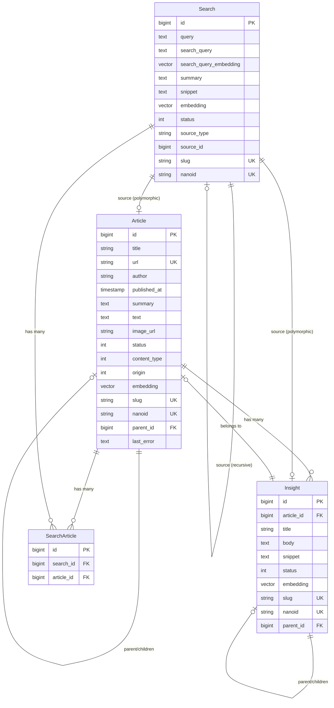

---

## 2. System Architecture Overview

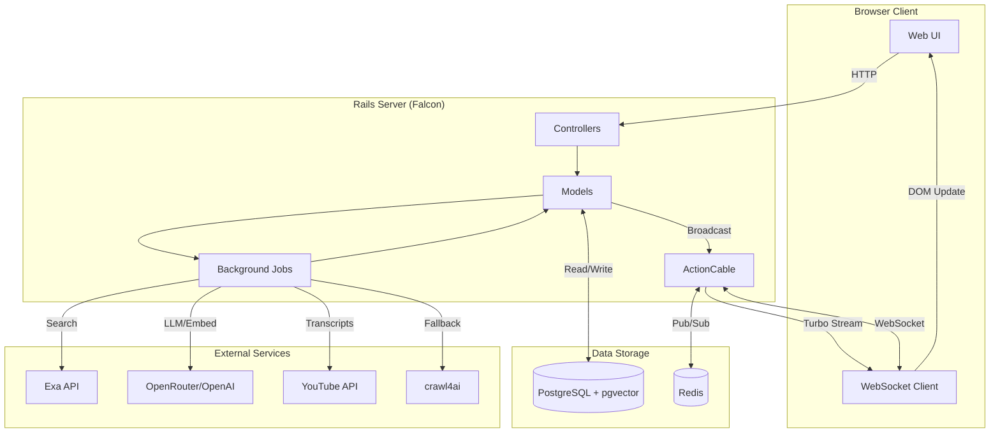

---

## 3. Article Ingestion Pipeline

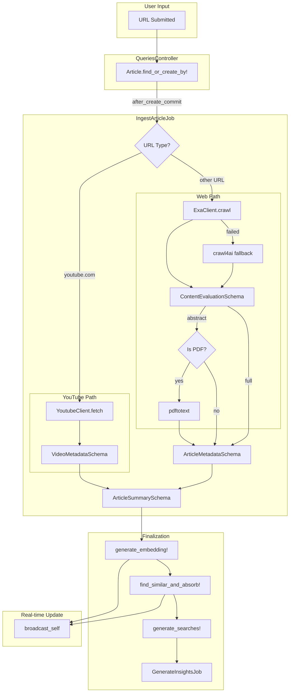

---

## 4. Insight Extraction Flow

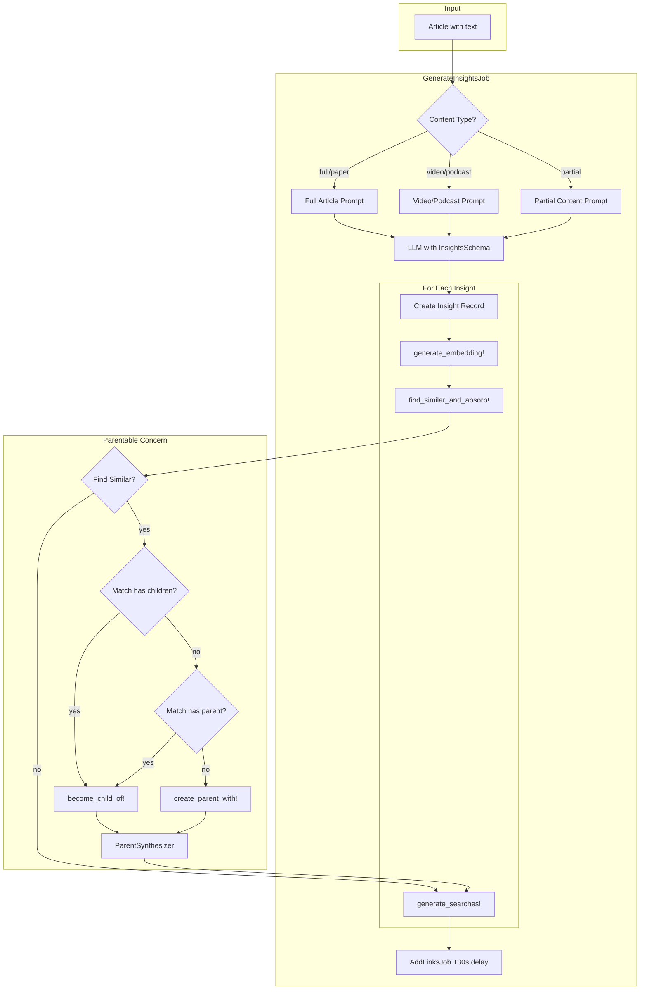

---

## 5. Search & Research Thread Flow

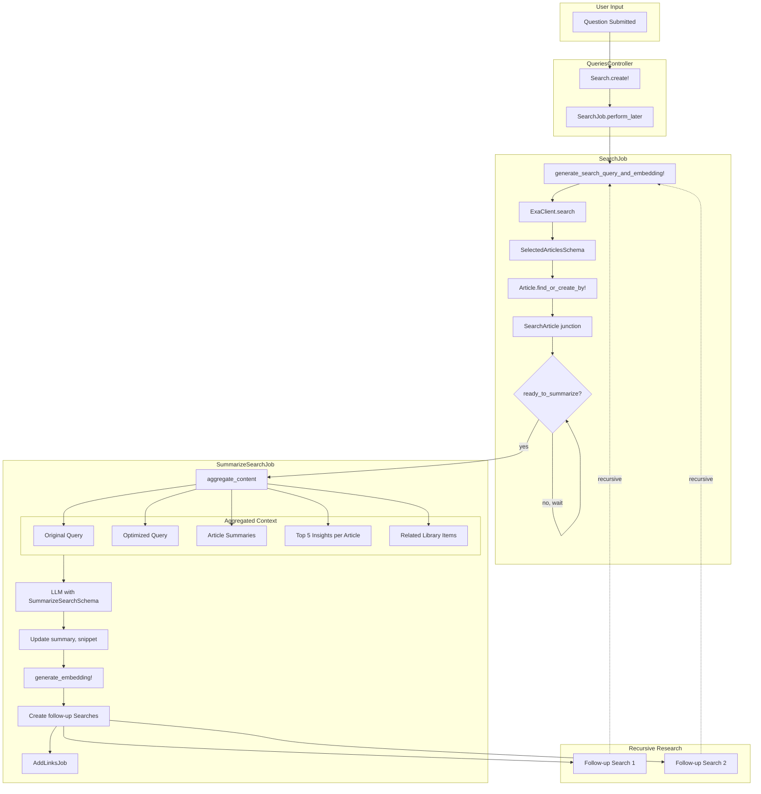

---

## 6. Auto-Clustering (Parentable) Flow

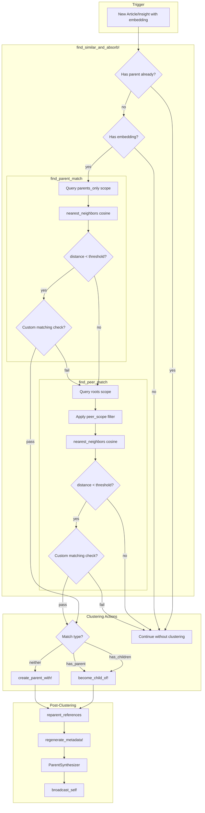

---

## 7. Real-Time Broadcast Flow

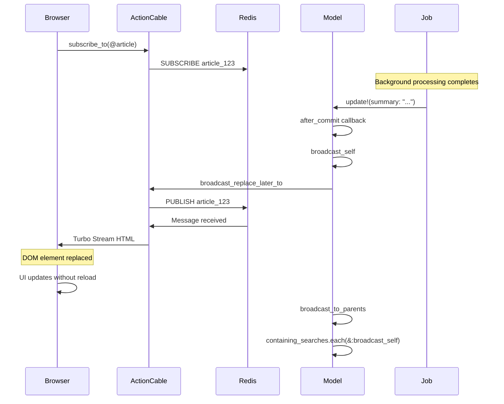

---

## 8. Concerns Architecture (Trait Composition)

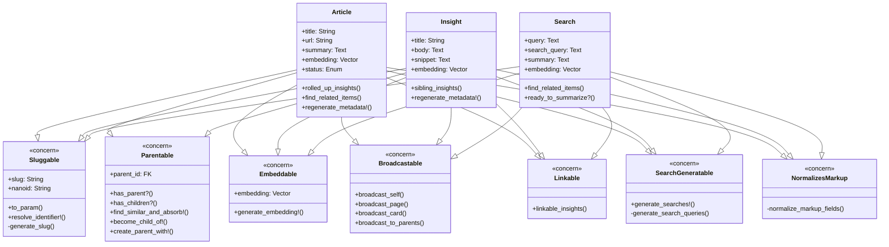

---

## 9. Job Pipeline Orchestration

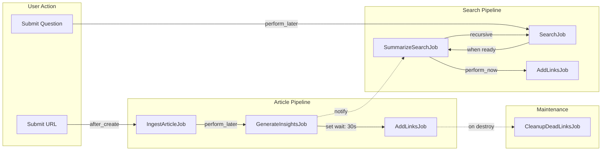

---

## 10. LLM Integration Points Map

```mermaid
flowchart TB
    subgraph Jobs["Background Jobs"]
        subgraph IngestJob["IngestArticleJob"]
            Eval[ContentEvaluationSchema<br/>Classify content type]
            VideoMeta[VideoMetadataSchema<br/>Extract speaker, title]
            ArticleMeta[ArticleMetadataSchema<br/>Extract author, date]
            ArticleSummary[ArticleSummarySchema<br/>200-300 char summary]
        end

        subgraph InsightsJob["GenerateInsightsJob"]
            InsightsExtract[InsightsSchema<br/>Extract key ideas]
        end

        subgraph SearchJobBox["SearchJob"]
            SelectArticles[SelectedArticlesSchema<br/>Choose 1-3 best results]
        end

        subgraph SummarizeJobBox["SummarizeSearchJob"]
            SynthesizeResults[SummarizeSearchSchema<br/>2-4 sentence synthesis]
        end

        subgraph LinksJob["AddLinksJob"]
            AddInternalLinks[Free-form prompt<br/>Add insight links]
        end
    end

    subgraph Models["Model Collaborators"]
        subgraph ArticleModel["Article"]
            SamenessCheck[SamenessCheck Schema<br/>Are articles identical?]
            ArticleSynth[ParentSynthesizer Schema<br/>Canonical cluster title]
        end

        subgraph InsightModel["Insight"]
            InsightSynth[ParentSynthesizer Schema<br/>Synthesize insights]
        end

        subgraph SearchModel["Search"]
            OptimizeQuery[Free-form prompt<br/>Optimize search query]
        end
    end

    subgraph Concerns["Concerns"]
        SearchGen[SearchGeneratable<br/>SearchQueriesSchema<br/>Generate research Qs]
    end

    subgraph LLM["LLM Provider"]
        Chat[LLM.chat<br/>Gemini 2.5 Flash]
        Embed[LLM.embed<br/>text-embedding-3-small]
    end

    Eval --> Chat
    VideoMeta --> Chat
    ArticleMeta --> Chat
    ArticleSummary --> Chat
    InsightsExtract --> Chat
    SelectArticles --> Chat
    SynthesizeResults --> Chat
    AddInternalLinks --> Chat
    SamenessCheck --> Chat
    ArticleSynth --> Chat
    InsightSynth --> Chat
    OptimizeQuery --> Chat
    SearchGen --> Chat

    ArticleSummary -.-> Embed
    InsightsExtract -.-> Embed
    SynthesizeResults -.-> Embed
```

---

## 11. User Experience Flow

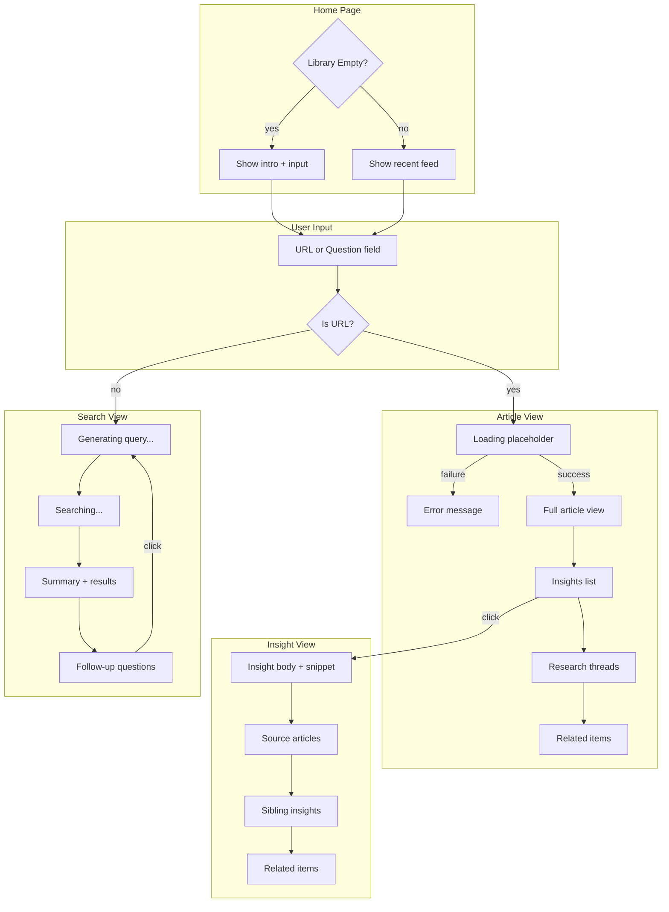

---

## 12. Data Storage Architecture

```mermaid
flowchart TB
    subgraph Application["Rails Application"]
        Models[ActiveRecord Models]
        Jobs[Background Jobs]
        Cable[ActionCable]
    end

    subgraph PostgreSQL["PostgreSQL Database"]
        subgraph Tables["Tables"]
            Articles[(articles)]
            Insights[(insights)]
            Searches[(searches)]
            SearchArticles[(search_articles)]
        end

        subgraph Extensions["Extensions"]
            PGVector[pgvector<br/>Vector similarity]
            PGCrypto[pgcrypto<br/>Random IDs]
        end

        subgraph Functions["Custom Functions"]
            NanoID[nanoid()<br/>Generate identifiers]
        end
    end

    subgraph Redis["Redis"]
        PubSub[Pub/Sub Channels]
        Cache[Application Cache]
    end

    Models <-->|CRUD| Tables
    Models <-->|Vector ops| PGVector
    Models -->|Generate ID| NanoID

    Jobs --> Models
    Models -->|Broadcast| Cable
    Cable <-->|Subscribe/Publish| PubSub

    Models <-.->|Cache| Cache
```

---

## 13. Extension Points for DKR

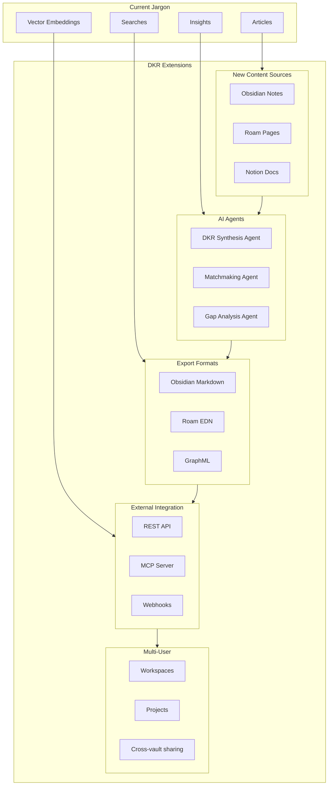

---

## 14. Totem Protocol Meta-Level View

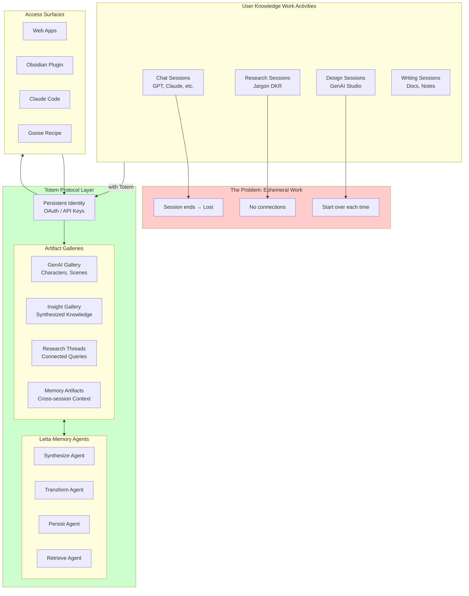

---

## 15. Second-Order Feedback Loop (Engelbart DKR)

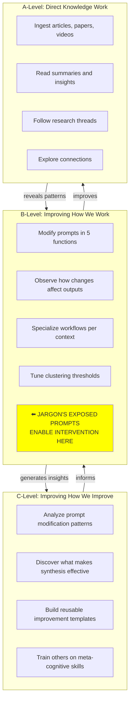

---

## 16. Workspace-Aware Agent Architecture

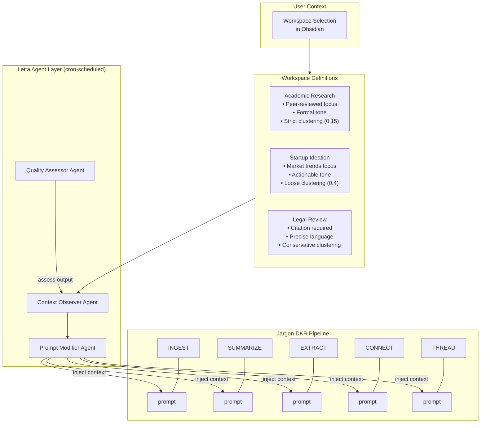

---

## 17. Mental Modelling Agency Curriculum

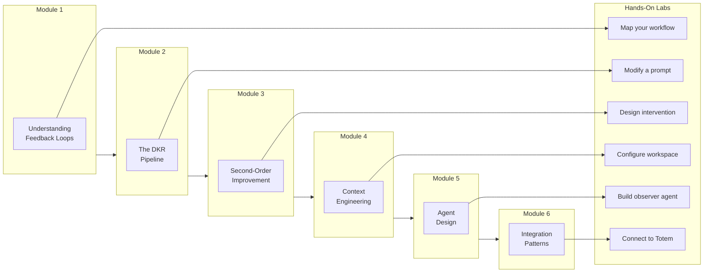

---

## 18. Jargon vs Perplexity Comparison

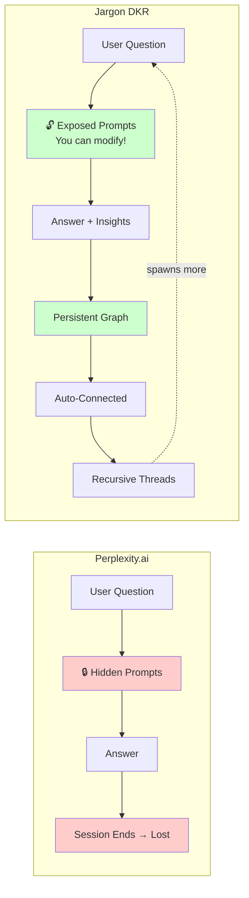

---

## Rendering These Diagrams

These diagrams use [Mermaid](https://mermaid.js.org/) syntax and can be rendered in:

1. **GitHub** - Renders automatically in markdown files
2. **VS Code** - Install "Markdown Preview Mermaid Support" extension
3. **Obsidian** - Built-in Mermaid support
4. **Online** - [Mermaid Live Editor](https://mermaid.live/)

To export as images:
```bash
# Install mermaid-cli
npm install -g @mermaid-js/mermaid-cli

# Convert to PNG
mmdc -i DIAGRAMS.md -o diagrams/ -e png
```

---

*Generated for Totem Protocol / DKR Prototype Development*
