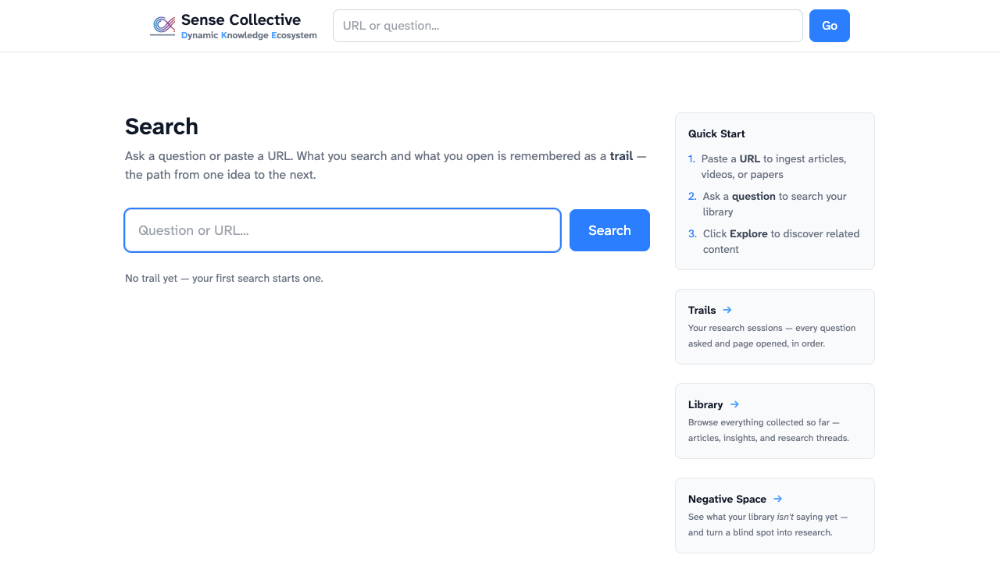
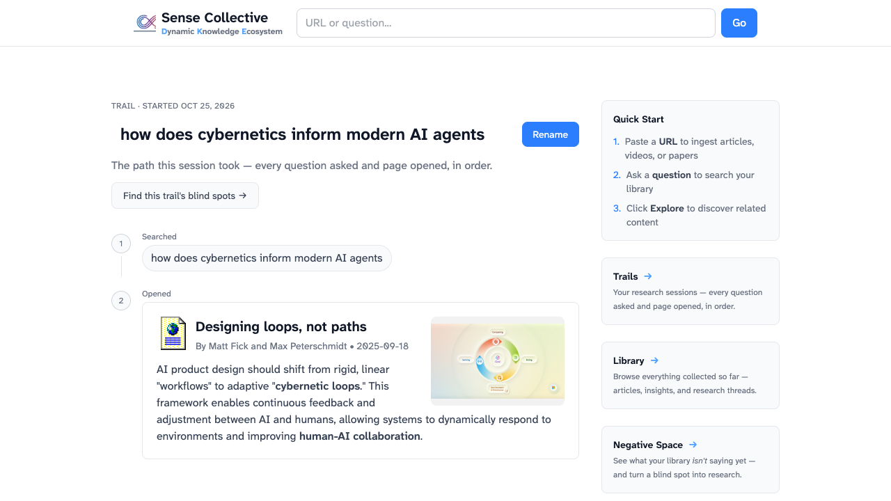
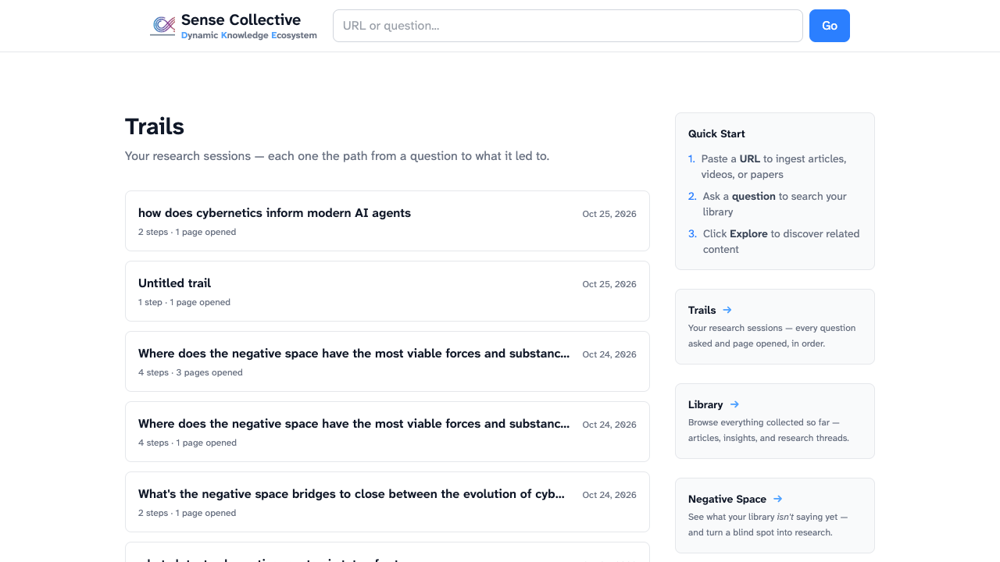
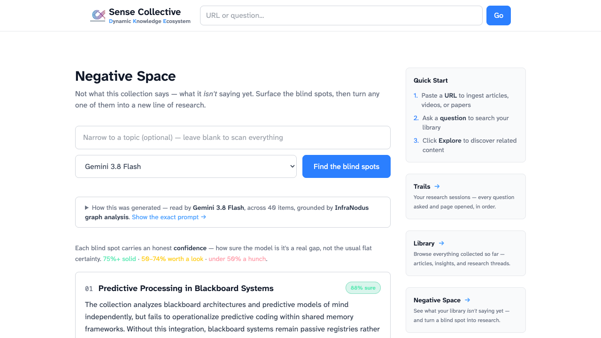
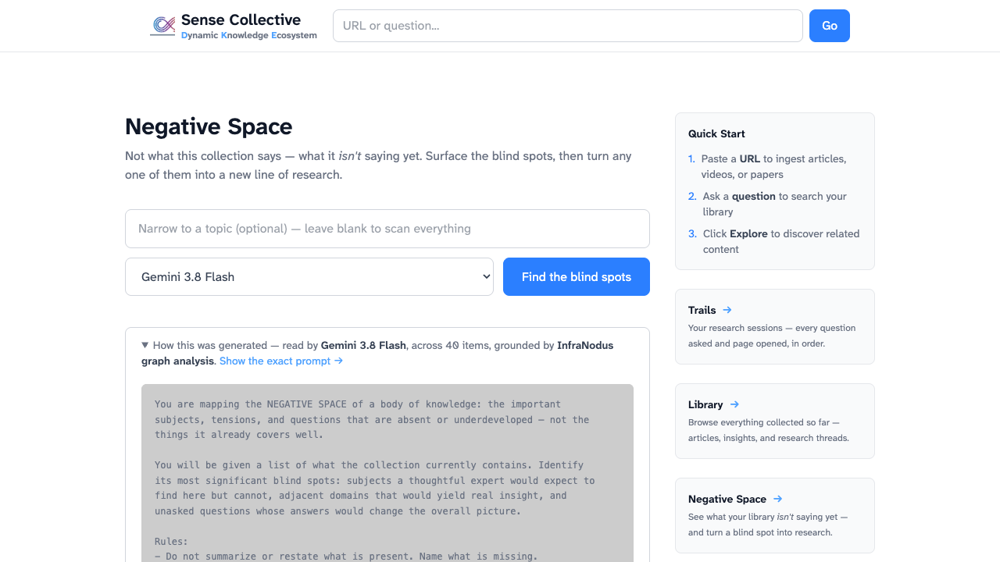
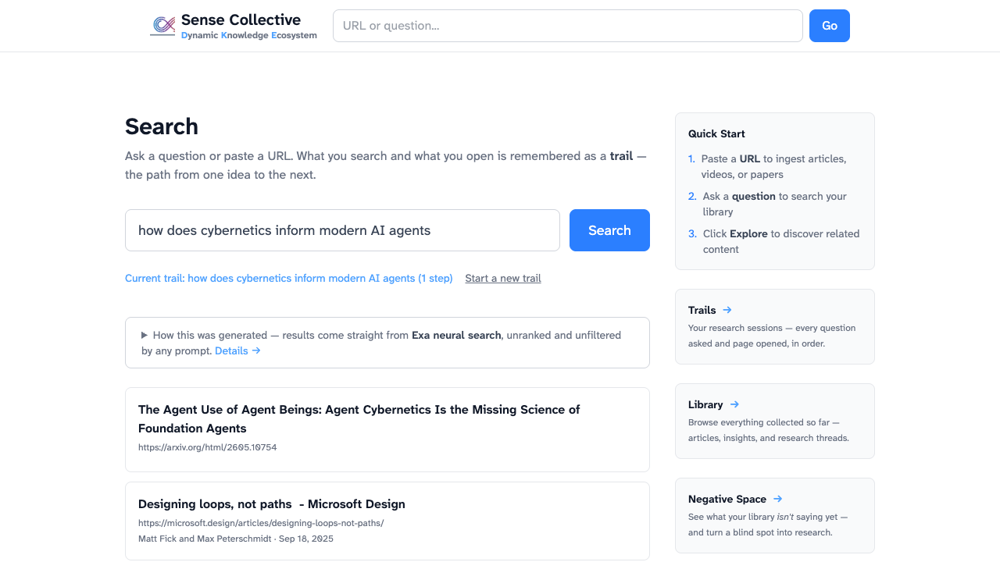
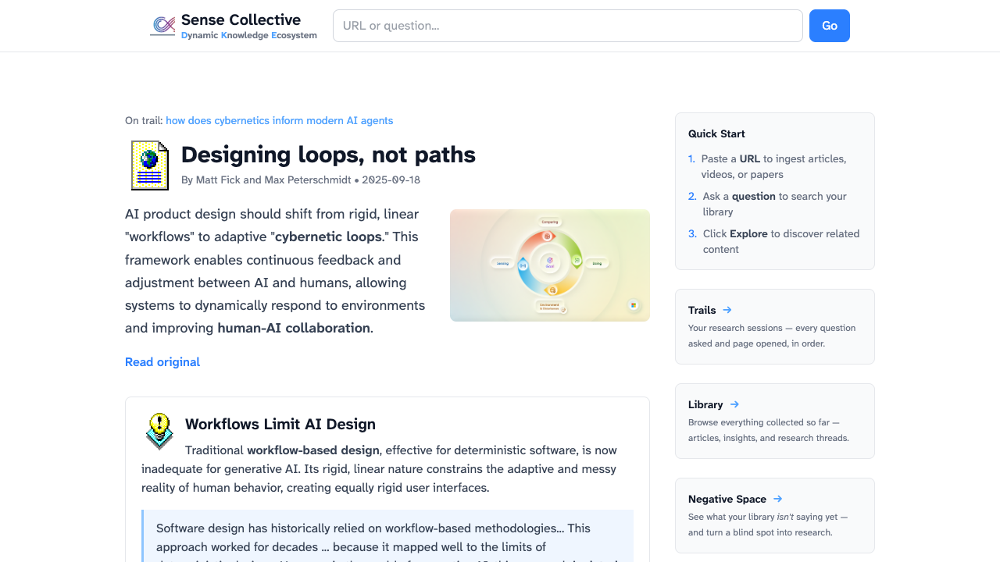

# Sense Collective, explained

*A detailed walkthrough of the glass-box search companion: trails, the library, and the
Negative Space Lens — with screenshots from a real session.*

---

## What this is

Sense Collective is a **search and browsing companion that remembers how you got there**. You
search and read inside it, and it does three things no ordinary search engine does:

1. **Captures your associative trail** — the sequence of questions and pages that led from one
   idea to the next. This is Vannevar Bush's memex trail ("As We May Think", 1945) made real:
   not your history, but your *path*.
2. **Connects each new page to everything you've already seen**, via a persistent knowledge
   graph of insight cards (Engelbart's Dynamic Knowledge Repository — knowledge that
   accumulates instead of evaporating like chat).
3. **Shows you the gaps** — not what your collection says, but what it *isn't saying yet*.

And it does all of it as a **glass box**: every prompt that shapes what you see is visible on
the page, and editable. Change the prompt, and watch the output change. That transparency is
the point — it's the open, educational sibling of ShurIQ's productized "Negative Space"
instrument.



---

## The core loop

Everything that enters the system passes through five functions, each driven by an exposed
prompt:

| # | Function | What happens | Where the prompt lives |
|---|----------|--------------|------------------------|
| 1 | **Ingest** | Articles, PDFs, and YouTube videos are scraped and parsed | `IngestArticleJob` |
| 2 | **Summarize** | An LLM distills each source into a concise summary | `IngestArticleJob` |
| 3 | **Extract** | Key ideas become standalone insight cards with source links | `GenerateInsightsJob` |
| 4 | **Connect** | Embeddings find related insights; duplicates collapse automatically | `Article::SamenessCheck` |
| 5 | **Thread** | Each card gets research questions that search the web for more sources | `SearchGeneratable` |

The library this builds — hundreds of interlinked insight cards — is the memory the trail
features sit on top of.

---

## Trails: the path is the product

A **Trail** is one research session, recorded as an ordered sequence of steps:

- **Searched** — a question you asked (live web results via Exa neural search)
- **Opened** — a page you read inside the app (which triggers the full ingest pipeline)
- **Explored** — a research thread you spawned from an insight or a blind spot

Your first search starts a trail automatically; it names itself after that question and can be
renamed inline. Nothing extra to do — the act of researching *is* the act of recording.

### A real session

Searching *"how does cybernetics inform modern AI agents"* returns live web results. Opening
"Designing loops, not paths" (Microsoft Design) ingests it — summary, key-term emphasis, and
insight cards appear within ~30 seconds — and the trail records both steps:



Note the two buttons: **Rename** (trails are durable objects you curate) and **"Find this
trail's blind spots →"** — more on that below.

### The trails index

Every session accumulates at `/trails`:



Real examples from this library:

- *"Where does the negative space have the most viable forces and substance…"* — 4 steps, 1 page opened
- *"What's the negative space bridges to close between the evolution of cyb…"* — 2 steps, 1 page opened
- *"how do ruby fibers enable async servers"* — 2 steps, 1 page opened

Notice the first two — those trails *started from blind spots the lens surfaced*. The loop is
circular: gaps become questions, questions become trails, trails fill gaps.

### Why this matters

Search engines optimize the single query; chat optimizes the single session. Both throw away
the connective tissue — *what led to what*. The trail is that tissue, kept. Six months from
now, "how did I end up reading about niche construction?" has an answer you can click through.

---

## Negative Space: what the collection *isn't* saying

The flagship lens. Instead of summarizing what you've collected, it names what a thoughtful
expert would expect to find and can't: missing perspectives, adjacent domains, unasked
questions.



### How a blind spot is found

Two signals combine:

1. **Measured structural gaps.** When InfraNodus is configured, the corpus is run through
   graph analysis: insights become a concept network, and the lens receives the measured gaps
   *between topic clusters* — places where two bodies of ideas sit in the library without a
   bridge between them. The page says so explicitly: *"grounded by InfraNodus graph analysis."*
2. **Model inference.** The exposed prompt (below) asks the model to name structural absences,
   prioritizing the measured gaps when present.

### Calibrated confidence

Every blind spot carries an honest 0–100 confidence — **not** the usual flat certainty.
The prompt instructs the model to reserve 80+ for gaps strongly implied by the corpus or
confirmed by measured structural gaps, and to say in one phrase what the number rests on.

Real output from this library (260+ insight cards, heavy on cybernetics, semantics, and
complex systems):

> **01 — Developmental and embodied bridging of semantic bootstrap and cognitive
> constructivism** · *86% sure · rests on: measured structural gap*
> Without this bridge, semantic bootstrapping remains either a formal-representational trick
> or a private construction; there is no account of how active cognition yields
> intersubjective, shareable meaning.
> *"What developmental trajectory lets an agent move from constructed sensorimotor categories
> to communicable symbols that others can bootstrap?"*

> **02 — Evolutionary epistemology, niche construction, and the
> open-evolution/constructivism bridge** · *83% sure · rests on: measured structural gap*
> Open-ended novelty and constructivist cognition sit apart, so there is no account of how
> evolutionary dynamics produce agents whose constructive cognition feeds back into the
> selection pressures themselves.

> **03 — Sub-symbolic-to-symbolic and formal bridge between semantic bootstrap and
> entailment networks** · *81% sure*
> The missing link is a mechanism — neural-symbolic, constraint-based, or proof-theoretic —
> that translates between bootstrapped meanings and inferential structure.

Each card ends with one concrete question and an **"Explore this →"** button.

### Closing the loop

"Explore this" turns the gap's question into a real research thread: the system searches the
web, ingests what it finds, extracts insights, and links them into the library — and records
an *Explored* step on your current trail. Run the lens again later and that blind spot has
measurably shrunk. **Gap → thread → sources → smaller gap.**

### Scoping

The lens runs at three scopes:

| Scope | Corpus | Question it answers |
|---|---|---|
| **Library** (default) | Most recent insight cards | "What is my whole collection missing?" |
| **Topic** | Cards nearest the topic by embedding | "What am I missing *about X*?" |
| **Trail** | The insights of the pages opened on one trail | "What has *this session* not looked at?" |

Trail scope is reached from any trail page ("Find this trail's blind spots →"); a topic typed
while trail-scoped narrows *within* the trail.

### Model switching

The same prompt runs against a selectable model — Gemini 3.8 Flash (default), Claude Opus 5.5,
Claude Sonnet 5.5, GPT-5.5, Grok 4.7, DeepSeek V4.1 Flash. The top blind spot often changes
with the model. That's a feature, not a bug: **a gap that survives every model is one to
trust; one that flickers is softer ground.**

---

## The glass box

Open "Show the exact prompt →" on the lens and you don't get documentation — you get the
actual instructions, in an editor:



This is the prompt, verbatim:

```
You are mapping the NEGATIVE SPACE of a body of knowledge: the important
subjects, tensions, and questions that are absent or underdeveloped — not the
things it already covers well.

You will be given a list of what the collection currently contains. Identify
its most significant blind spots: subjects a thoughtful expert would expect to
find here but cannot, adjacent domains that would yield real insight, and
unasked questions whose answers would change the overall picture.

Rules:
- Do not summarize or restate what is present. Name what is missing.
- For each blind spot, explain why its absence matters.
- Prefer structural gaps (a whole missing perspective) over small omissions.
- End each with one concrete question that would begin to fill the gap.
- Give each a CALIBRATED confidence (0-100) that it is a real, significant gap.
  Be honest and do not inflate: reserve 80+ for gaps strongly implied by what is
  present or confirmed by measured structural gaps; use 45-65 for reasonable
  inferences; go below 40 when speculative. Say in one phrase what it rests on.

If you are also given measured structural gaps between topic clusters, treat them
as strong evidence of where the negative space lies — prioritize them and rate
them with higher confidence.
```

Edit it — say, add *"focus on contrarian perspectives"* — hit **Save prompt**, re-run, and
the blind spots change. An amber **"edited prompt"** badge marks the departure from default;
**Reset to default** restores it. The default always lives in code; only your edits live in
the database.

Why expose this? Three reasons, in ascending order of ambition:

1. **Trust.** A tool that shows its reasoning can be checked; one that hides it must be taken
   on faith.
2. **Education.** Watching how a prompt shapes output is the fastest way to build a working
   mental model of what these systems do.
3. **Second-order improvement** (Engelbart's B-level): the system doesn't just do knowledge
   work — it lets you improve *how* it does knowledge work, and observe the effect. Most AI
   products stop at level A.

---

## A worked session, end to end

1. **Ask** — type a question on the front door. Live results, each one openable.
   
2. **Read** — open a result. It ingests through the five-function loop; an "On trail" banner
   and a related-items panel ("connects to what you've seen") appear as it completes.
   
3. **Branch** — search again, open more pages. Every step lands on the trail in order.
4. **Review** — the trail page replays the path; rename it to keep it.
5. **Interrogate** — "Find this trail's blind spots." Read what the session skipped.
6. **Close a gap** — "Explore this" on the sharpest blind spot. The thread's discoveries flow
   into the library.
7. **Repeat** — next session, the connect-step links new reading back to everything this one
   left behind.

---

## Under the hood (one paragraph)

Rails 8 + Hotwire; Falcon (fiber-based async server) with in-process background jobs
(async-job); PostgreSQL + pgvector for embeddings and nearest-neighbor search; RubyLLM as the
unified LLM interface (OpenRouter by default, so models are swappable per request);
Exa neural search for both the front door and research threads; InfraNodus for measured
structural gaps; crawl4ai and pdftotext as scraping/extraction fallbacks. Trails are two
tables (`trails`, ordered polymorphic `trail_steps`); prompt overrides are one (`prompts`,
keyed, override-or-default). The product spec lives in `docs/SEARCH_COMPANION_SPEC.md`.

*Sense Collective is a fork of [Jargon](https://github.com/schoblaska/jargon) by @schoblaska
(GPL-3.0), which provides the ingestion/extraction/linking foundation.*
